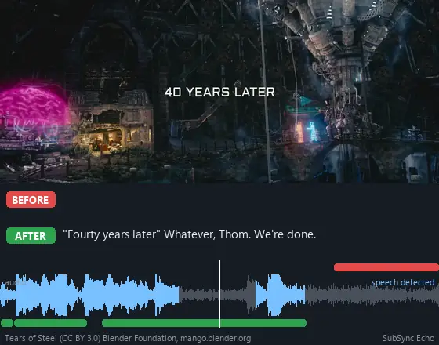
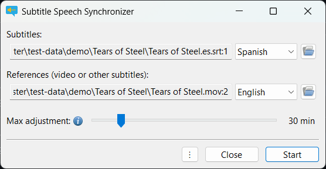
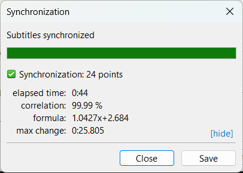

# SubSync Echo

[](https://github.com/Z0rdic/SubSync-Echo/actions/workflows/build.yml)
[](https://github.com/Z0rdic/SubSync-Echo/releases/latest)
[](LICENSE)


**Subtitles out of sync with your video? SubSync Echo fixes them for you.** It listens to what is said in the film and moves every subtitle line to the moment it's spoken. It works with anime and other Japanese films, and with subtitles in a different language from the audio. Everything runs on your own computer, with no graphics card, and nothing is uploaded.

<p align="center"></p>

<p align="center"><sub>English subtitles of <a href="https://mango.blender.org">Tears of Steel</a>, mistimed (before) and synced by SubSync Echo (after, the app's own output in its end-to-end test). Blue marks where SubSync's speech detector hears speech; the bars show when each file shows its lines. Before, "Robot's memory synced and locked!" appears 4.6 seconds early, while no one is speaking.</sub></p>

<p align="center"><b><a href="https://github.com/Z0rdic/SubSync-Echo/releases/latest">⬇ Download for Windows or Linux</a></b> · <a href="CHANGELOG.md">What's new</a> · <a href="#questions">Questions</a></p>

## Quick start

1. **Download** `subsync-<version>-portable-amd64.exe` from [Releases](https://github.com/Z0rdic/SubSync-Echo/releases/latest), run it to unpack, and open **`subsync.exe`** in the new `subsync` folder. (Linux: see [Installing](#installing).)
2. **Choose your subtitles and your video,** set the language of the subtitles, and click **Start**.
3. When it says **Subtitles synchronized**, click **Save**.

The first time, SubSync downloads its speech model once (about 490 MB). After that it works offline.

<p align="center">

&nbsp;

</p>

<p align="center"><sub>Spanish subtitles on the English film Tears of Steel, mistimed by a frame-rate difference and 2.5 seconds. A first run, with no transcript or translation kept from before: 44 seconds for the 12-minute film on the test laptop.</sub></p>

## Is this for me?

**Yes, if your subtitles:**
- are a few seconds early or late all the way through;
- start right but drift further off as the film goes on (they were made for a different frame rate);
- were made for a different release of the film, with scenes added or removed;
- are for anime or another Japanese film, or are in a different language from the audio, such as English subtitles on a Japanese film.

**It's not the right tool if:**
- you have no subtitles yet. SubSync Echo fixes the timing of subtitles you have; it doesn't write new ones.
- the subtitles are burned into the picture. It needs a subtitle file, or text subtitles stored inside the video file (as in many `.mkv` files).
- you use a Mac. It runs on Windows and Linux.
- your computer has less than 8 GB of RAM.

It keeps your subtitle text and styling exactly as they were and changes only the timing.

## Installing

**You need:**
- 64-bit Windows 10 or 11, or 64-bit Linux with glibc 2.35 or newer: Ubuntu 22.04 or newer, Debian 12, Fedora 36, Linux Mint 21 and similar.
- 8 GB of RAM. It uses about 1–1.6 GB while syncing.
- About 1 GB of disk space: 410 MB for the app and 490 MB for the speech model, plus 490 MB for the translation model if your subtitles aren't in English.
- Internet once, the first time a model is needed, to download it.

**Windows**
1. Download **`subsync-<version>-portable-amd64.exe`** from **[Releases](https://github.com/Z0rdic/SubSync-Echo/releases/latest)**.
2. Run it and choose where to unpack, for example `Downloads`. It creates a `subsync` folder.
3. Open that folder and run **`subsync.exe`**.

The same app is also available as a zip (`subsync-<version>-windows-x64.zip`). Unzip it anywhere and run `subsync.exe`.

Windows may show *"Windows protected your PC"* the first time, because SubSync is new and not yet known to Windows. Click **More info**, then **Run anyway**.

**Linux:** download `subsync-<version>-linux-x86_64.tar.xz`, unpack it anywhere and run the app:

```
tar xf subsync-<version>-linux-x86_64.tar.xz
./subsync/subsync
```

Nothing is installed; the `subsync` folder holds everything. To remove SubSync, delete that folder, and the models if you like (see [where they are](#questions)). `./subsync/subsync-cmd` is the command line version.

To check that a download wasn't changed, compare its checksum with the `SHA256SUMS` file on the release page ([how](SECURITY.md#release-files)).

## Using it

1. **Subtitles:** choose your subtitle file and set its language, for example **English**.
2. **References:** choose the video file. If its language box stays empty, leave it: SubSync detects the spoken language when you click Start (about 5–15 seconds).
3. Click **Start**. The first time only, agree to download the speech model (about 490 MB), and for subtitles that aren't in English, the translation model (about 490 MB).
4. When it says **Subtitles synchronized**, click **Save**.

To sync several files at once, open the menu (**⋮**) and choose **Batch processing**.

**What the messages mean:**

| Message | Meaning |
|---|---|
| **Subtitles synchronized** | Done. The timing was confirmed by the transcribed parts, and by the speech in every stretch of the film with enough dialogue to judge. |
| **Couldn't synchronize** | The timing couldn't be confirmed, so no file is saved rather than saving wrong timing. See [Questions](#questions). |
| **Subtitles do not fit this video as a whole, they may be made for a different cut or release** | The subtitles are for another version of the film, and piece-by-piece sync couldn't confirm a result either. Try subtitles made for your release. |
| **Couldn't download the speech recognition model** (or **the translation model**)**, check your internet connection** | The first-time download failed. Connect and click Start again; it resumes where it stopped. |

## How well it works

Every number here comes from a real test run: correct subtitles were deliberately mistimed, synced with SubSync Echo, and compared line by line with the correct timing. A difference under 0.2 seconds isn't noticeable when watching.

- **Japanese films with English subtitles:** 7 of 9 films had every line within 0.2 s.
- **Tears of Steel**, a free English short film, in 6 subtitle languages: every line within 0.2 s, in all 6.
- **Sita Sings the Blues**, a free 82-minute film where a third of the lines are sung: every line within 0.2 s, songs included, in 4 of 5 languages.
- **English films with English subtitles:** 7 of 11 had 99.8–100% of lines within 0.2 s. The other 4 came out shifted by the same 0.2–0.5 s on every line, because those files are timed in a different style (see [Questions](#questions)).
- When it can't confirm the timing, it **saves nothing** rather than saving wrong subtitles.
- **Time,** on a laptop with no graphics card (AMD Ryzen 9 5900HX, 8 GB of RAM): 1.5–2.5 minutes for most films the first time, seconds when syncing the same film again. Subtitles that aren't in English add 1–2.5 minutes the first time, for translating them.

The full tables, which languages work how and how it works inside are in [doc/results.md](doc/results.md); the test method is in [doc/benchmark.md](doc/benchmark.md). Two of the tests download free films and run before every release, so anyone can repeat them.

## Questions

<details>
<summary><b>Is it free?</b></summary>

Yes. It's free and open source under the [GPL-3.0](LICENSE), with no account and no ads.

</details>

<details>
<summary><b>Is my video uploaded anywhere?</b></summary>

No. Speech recognition and translation run on your computer. The only things downloaded are the models, once (see [Your privacy](#your-privacy)).

</details>

<details>
<summary><b>Do I need a graphics card or a fast computer?</b></summary>

No graphics card: it runs on the processor. The times above were measured on a laptop with an AMD Ryzen 9 5900HX processor and 8 GB of RAM; a slower processor takes longer.

</details>

<details>
<summary><b>Will it change the text or style of my subtitles?</b></summary>

No. Only the times change.

</details>

<details>
<summary><b>Which files does it work with?</b></summary>

Subtitles: `.srt`, `.ass`, `.ssa`, `.sub` (MicroDVD), `.txt` (TMP), or text subtitles stored inside a video file. Video: `.mkv`, `.mp4`, `.avi`, `.mov`, `.webm` and most other formats.

</details>

<details>
<summary><b>Which languages does it work with?</b></summary>

Japanese and English audio are tested, with subtitles in English, Japanese, Spanish, German, Italian, Dutch, Russian, Chinese, Czech, Polish, Portuguese, Bulgarian and French. More audio languages use the same method but haven't been tested yet; [doc/results.md](doc/results.md#which-languages-work-how) lists them.

</details>

<details>
<summary><b>It says "Couldn't synchronize". What can I try?</b></summary>

- Check that the subtitles are for this film and, if you can, for this release of it.
- Check the subtitle language you chose. If you set the video's language by hand, check that too.
- Films with very little dialogue give less to go on; another subtitle file may work better.
- If it still fails, [report it](https://github.com/Z0rdic/SubSync-Echo/issues/new?template=bug_report.yml) with a log (see [Troubleshooting](#troubleshooting)).

</details>

<details>
<summary><b>Every line is a little early or late, always by the same amount. Why?</b></summary>

Subtitle makers time lines differently: some show a line just before people speak, some just after. SubSync shows each line a moment before speech (0.25 s, or 0.15 s for English-language films). If you prefer another style, change **Settings → Output timing offset**.

</details>

<details>
<summary><b>Can it sync subtitles on my media server (Jellyfin, Plex, Emby) automatically?</b></summary>

*Not yet.* A home-server version that watches your media folders is planned for a later release; it isn't built. Today you can sync from the command line (see [For advanced users](#for-advanced-users)).

</details>

<details>
<summary><b>Does it work on a Mac?</b></summary>

No. It runs on Windows and Linux.

</details>

<details>
<summary><b>How is it different from the original SubSync?</b></summary>

SubSync Echo continues the original [SubSync](https://github.com/sc0ty/subsync), which is no longer maintained. It adds the Whisper speech recognition model and translation, so it works where the original couldn't: Japanese films and subtitles in a different language from the audio. It also checks its timing against the speech detected in the whole film before saving. The program and its files keep the name `subsync`.

</details>

<details>
<summary><b>Where does it keep its files, and can I delete them?</b></summary>

- Models: `%USERPROFILE%\.cache\huggingface\hub` on Windows, `~/.cache/huggingface/hub` on Linux. Deleting them means downloading them again next time.
- Transcripts and translations, which make a second sync of the same film quick: `%TEMP%\subsync-transcripts` and `%TEMP%\subsync-translations`. These can be deleted at any time.

</details>

## Your privacy

Speech recognition and translation run on your computer. Your videos and subtitles are never uploaded. The only downloads are the speech and translation models, from `huggingface.co`, always the exact versions SubSync was tested with, and, for languages handled by the original method, the original SubSync's speech models and dictionaries. [SECURITY.md](SECURITY.md) lists how each download is checked, how to verify a release file with its checksum, and how to report a security problem.

## Known limits

- Lines are timed to start a moment before people speak: 0.25 s for films in other languages and 0.15 s for English-language films, the typical values measured on 26 subtitle files. Some subtitles are timed differently, for example showing each line after the speech starts; the result then differs from them by up to a second. Adjust it in **Settings**, under **Output timing offset**.
- Within a few lines of a cut, some lines may land on the wrong side.
- Of the audio languages Whisper adds, only Japanese has been tested so far (and English, through translation). These use the same method but are untested: Albanian, Arabic, Belarusian, Bulgarian, Catalan, Croatian, Czech, Danish, Estonian, Faroese, Finnish, Galician, Hebrew, Hungarian, Icelandic, Indonesian, Korean, Latin, Latvian, Lithuanian, Malagasy, Malay, Maltese, Norwegian, Persian, Polish, Portuguese, Romanian, Serbian, Slovak, Slovenian, Swedish, Turkish, Ukrainian.
- All other languages work as in the original SubSync, without the Whisper fallback English has.
- English subtitles on an English film take longer when the original method can't sync them: it listens to the whole film first, then Whisper takes over and adds the usual Whisper time. The command line downloads the speech model for this the first time (unless run with `--offline`); in the app window, the fallback is used only when the model is already downloaded, for example after syncing a film in another language.
- In videos under 30 minutes, subtitles with a speed difference that isn't a frame-rate conversion aren't synced (no file is saved).
- Automatic updates are turned off. New versions appear on the [Releases](https://github.com/Z0rdic/SubSync-Echo/releases) page.

## Troubleshooting

- **To save a log of what SubSync does:**
  1. Open the SubSync folder, click the address bar, type `cmd` and press Enter.
  2. Run `subsync.exe --loglevel=INFO --logfile=log.txt`.
  3. Repeat the sync. The log is written to `log.txt`.

  On the command line, add the same two options to `subsync-cmd.exe`.
- **To report a problem,** use the [bug report form](https://github.com/Z0rdic/SubSync-Echo/issues/new?template=bug_report.yml) and include the log.

## For advanced users

**Command line:**

```
subsync-cmd.exe --cli sync --sub movie.en.srt --sub-lang=eng --ref movie.mkv --ref-stream-by-type=audio --ref-lang=jpn --out movie.synced.srt
```

Run `subsync-cmd.exe --help` for all options.

**Another Whisper model:** SubSync uses Whisper's `small` model. To try another one, set the environment variable `SUBSYNC_WHISPER_MODEL` to its size (for example `medium`) before starting SubSync. Smaller models aren't faster here: `tiny` (75 MB) failed to sync all 4 films it was tested on, and `base` (145 MB) failed 1 of 4 and was slower than `small` on the rest, because SubSync needed more parts of the film before it could confirm the timing.

**Building from source and running the tests:** see [doc/development.md](doc/development.md). Unit tests run on every build; two end-to-end tests on free films run on both packages before every release, and a release is published only when they pass.

## License and credits

SubSync is free software under the [GNU General Public License v3](LICENSE).

- Based on [SubSync](https://github.com/sc0ty/subsync) by Michał Szymaniak, GPL-3.0.
- Speech recognition: [faster-whisper](https://github.com/SYSTRAN/faster-whisper) and [CTranslate2](https://github.com/OpenNMT/CTranslate2) (MIT), with OpenAI's [Whisper](https://github.com/openai/whisper) `small` model (MIT), downloaded from [Hugging Face](https://huggingface.co/Systran/faster-whisper-small).
- Speech detection: [Silero VAD](https://github.com/snakers4/silero-vad) (MIT), through [ONNX Runtime](https://github.com/microsoft/onnxruntime) (MIT).
- Speech recognition for other languages: [CMU Sphinx](https://github.com/cmusphinx) (BSD).
- Translation: Meta's [M2M100](https://huggingface.co/facebook/m2m100_418M) 418M model (MIT), in the [CTranslate2 conversion by jncraton](https://huggingface.co/jncraton/m2m100_418M-ct2-int8) (MIT), with [SentencePiece](https://github.com/google/sentencepiece) (Apache-2.0).
- Audio and video: [FFmpeg](https://ffmpeg.org) 5.1.2, the [gyan.dev](https://www.gyan.dev/ffmpeg/builds/) full shared build (GPL-3.0); source code at [ffmpeg.org/releases/ffmpeg-5.1.2.tar.xz](https://ffmpeg.org/releases/ffmpeg-5.1.2.tar.xz). Also [PyAV](https://github.com/PyAV-Org/PyAV) (BSD).
- Test films: [Tears of Steel](https://mango.blender.org) by the Blender Foundation (CC-BY 3.0), shown in the clip above and used in the end-to-end test, and [Sita Sings the Blues](https://sitasingstheblues.com) by Nina Paley (public domain, CC0), with community subtitles from [Amara](https://amara.org/en/videos/YkwgVDEZTA0g/info/) and [archive.org](https://archive.org/details/SitaSingsTheBluesCsSubtitles); the tests download them, they aren't included.
- Window: [wxPython](https://wxpython.org) (wxWindows Library Licence). Subtitles: [pysubs2](https://github.com/tkarabela/pysubs2) (MIT). Engine bindings: [pybind11](https://github.com/pybind/pybind11) (BSD).
